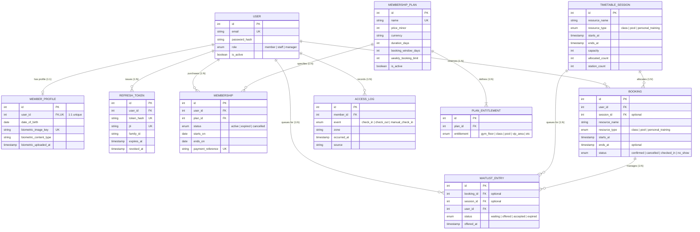

# BFS Gym API

BFS Gym is a gym membership and facility-access management API. The gym offers a gym floor, swimming pool, fitness classes, personal training sessions, and VIP wellness rooms (sauna, massage, and cold plunge).

This repository is a proof-of-concept monolithic REST API. It demonstrates object-oriented analysis and design, domain business rules, architectural patterns, and automated testing. It is not a complete production gym-management system.

## Gym Background

BFS Gym serves three tiers of members:

- **Standard members** access the gym floor and can book fitness classes.
- **Premium members** additionally access the swimming pool, personal training, and the VIP wellness suites.
- All members are identified at entry doors by a biometric scanner that compares their live face against their enrolled photo.

The business rules include membership plans with configurable booking windows and weekly limits, VIP room capacity enforcement with automatic waiting lists, booking eligibility checks before any reservation is accepted, and automated notifications when significant events occur.

## User Roles

| Role | What they can do |
|---|---|
| **Member** | Register, purchase/renew/cancel membership, book eligible activities, check in to sessions, receive in-app notifications |
| **Staff** | Everything a member can do, plus manually check in a member and view live zone occupancy |
| **Manager** | Everything staff can do, plus create and configure membership plans and view business reports |
| **Biometric scanner** | A trusted hardware device (identified by a secret device key) that submits check-in requests after a face-match |

## Implemented Features

- JWT authentication (access + refresh tokens) with member, staff, and manager roles.
- Membership plans (Basic, Standard, Premium) with entitlement-based access control.
- Stripe Checkout gateway (sandbox mode) and a verified webhook-receipt endpoint; membership activation remains pending webhook lifecycle work.
- Booking creation, listing, cancellation, and eligibility feedback (active membership, plan entitlement, booking window, weekly limit, same-start conflict checks).
- VIP occupancy tracking, automatic waiting lists, and visit expiry using Redis sorted sets.
- Scanner/device check-in with configurable device keys and zone-specific access policies.
- Member biometric photo upload for enrolment reference.
- In-app notification model with Redis Pub/Sub delivery and SSE streaming *(in progress)*.
- **Optional AI Integrations**:
  - **Feature A (Pydantic AI)**: Intelligent workout and class recommender using the Strategy pattern.
  - **Feature C (Computer Vision)**: Biometric photo quality validation using the Chain of Responsibility pattern.

## Design Patterns

| Pattern | Where it is used | Status |
|---|---|---|
| **Strategy** | `GymFloorPolicy` and `VipAreaPolicy` in `app/modules/access/policies.py` — zone access policies | ✅ Implemented |
| **Strategy (AI Extension)** | `RecommendationStrategy` (`PydanticAIStrategy`, `PopularityStrategy`) for class recommendations | 💡 Optional / Documented |
| **Chain of Responsibility** | Booking eligibility rules in `app/modules/bookings/eligibility.py` — collect all validation failures | ✅ Implemented |
| **Chain of Responsibility (Vision)** | `PhotoValidationHandler` chain in `app/modules/members/` — checks resolution, illumination, blur, and face presence | 💡 Optional / Documented |
| **Factory Method** | `PaymentGatewayFactory.create(settings)` in `app/modules/memberships/payment_gateway.py` — payment provider factory | ✅ Implemented |
| **Observer** | `NotificationPublisher` + Redis Pub/Sub + SSE endpoint — business events push notifications | 🔧 In progress |
| **State** | `ActiveState`, `ExpiredState`, `CancelledState` in `app/modules/memberships/states.py` — membership lifecycle | ✅ Implemented |
| **Builder** | `BookingContextBuilder` in `app/modules/bookings/builder.py` — assembles complex `BookingContext` for Chain of Responsibility | ✅ Implemented |

## Architecture

The project follows a **monolithic MVC/REST architecture**:

- **Models** (`app/models/`) — SQLAlchemy ORM models define the database schema.
- **Services** (`app/modules/*/service.py`) — contain all business logic; routers never query the database directly.
- **Routers/Controllers** (`app/modules/*/api_v1.py`) — FastAPI route handlers that validate requests, call services, and return responses.

### Data Models & Entity Relationships

The relational domain model is built on SQLAlchemy 2.0 with strict foreign key constraints, cascading policies, and uniqueness rules:



#### Key Relationships and Integrity Constraints

| Parent Model | Relationship | Child Model | Foreign Key / Constraint | Cascade / On-Delete | Description |
|---|---|---|---|---|---|
| `User` | **1 : 1 (Optional)** | `MemberProfile` | `member_profiles.user_id` (Unique) | `RESTRICT` (orphan-removal in ORM) | One-to-one link storing date of birth and biometric photo keys for facial verification. |
| `User` | **1 : N** | `RefreshToken` | `refresh_tokens.user_id` | `CASCADE` | Stores rotating JWT refresh tokens with family tracking and revocation. |
| `User` | **1 : N** | `Membership` | `memberships.user_id` | `RESTRICT` | Tracks past, current, and renewed membership contracts per member. |
| `User` | **1 : N** | `Booking` | `bookings.user_id` | `RESTRICT` | Active and historical facility reservations made by the member. |
| `User` | **1 : N** | `WaitlistEntry` | `waitlist_entries.user_id` | `RESTRICT` | Tracks session waitlist positions requested by the member. |
| `User` | **1 : N** | `AccessLog` | `access_logs.member_id` | `None` (Audit Log) | Immutable historical audit trail of turnstile check-ins and check-outs. |
| `MembershipPlan` | **1 : N** | `PlanEntitlement` | `plan_entitlements.plan_id` | `CASCADE` (delete-orphan) | Defines feature privileges (e.g., VIP sauna access, pool bookings) granted by each plan tier. Unique on `(plan_id, entitlement)`. |
| `MembershipPlan` | **1 : N** | `Membership` | `memberships.plan_id` | `RESTRICT` | Associates purchased memberships with their parent plan rules (pricing, booking window, weekly limits). |
| `TimetableSession` | **1 : N** | `Booking` | `bookings.session_id` | `RESTRICT` | Links member bookings to scheduled classes, pool slots, or personal training blocks. |
| `TimetableSession` | **1 : N** | `WaitlistEntry` | `waitlist_entries.session_id` | `RESTRICT` | Queue of members waiting for spots on full timetable sessions. Unique on `(session_id, user_id)`. |
| `Booking` | **1 : N** | `WaitlistEntry` | `waitlist_entries.booking_id` | `RESTRICT` | Legacy queue linked directly to ad-hoc bookings. Unique on `(booking_id, user_id)`. |

## Why No External Cloud AI for Door Scanners

The biometric scanner feature uses **offline face comparison** (a local Python library, no external API key). Real gym door scanners have embedded face-recognition chips. Our API trusts the scanner's result (device key + template ID + confidence score) and enforces the business rules — it does not need to replicate face recognition in an external AI service.

Application-level AI extensions (such as **Pydantic AI** for workout recommendations and **OpenCV** for enrolment photo quality checks) are designed as decoupled, pluggable strategies with deterministic fallbacks to preserve system reliability and testability. See [Implementation Guide](docs/implementation-guide.md#optional-ai-features) for full code examples.

## Why No Celery

Celery was originally added as a notification queue placeholder, but it is not needed:

- **Stripe webhooks** are signature-verified synchronously inside the FastAPI endpoint — no background queue is needed. Membership activation will be added with the pending-payment lifecycle.
- **In-app notifications** are delivered via Redis Pub/Sub + Server-Sent Events (SSE) — this is instant push delivery; a queue would only add latency.
- **Periodic background jobs** (waitlist expiry, no-show detection) are handled by APScheduler, which runs inside the FastAPI process with no extra Docker service or infrastructure.

Removing Celery simplifies the stack from three services (API + Celery worker + queue-Redis) to one (API), while the Redis container that already exists for VIP occupancy is reused for Pub/Sub.

## Local Development

Copy `.env.example` to `.env` and replace placeholder values. You will need a Stripe test account — get a test secret key from [https://dashboard.stripe.com/test/apikeys](https://dashboard.stripe.com/test/apikeys).

Start a local PostgreSQL instance (or use any existing one) and a local Redis container:

```powershell
uv sync --all-groups
docker compose -f compose.local.yml --env-file .env up -d
uv run --env-file .env alembic upgrade head
uv run --env-file .env fastapi dev app/main.py
```

## Full Docker Setup

Copy `.env.docker.example` to `.env.docker` and replace placeholder secrets, then start the full stack:

```powershell
docker compose --env-file .env.docker up --build
```

The `migrate` service applies the schema before the API starts. Swagger is available at `http://localhost:8000/docs`; pgAdmin at `http://localhost:5050`.

### Enable Stripe webhook forwarding

To test payments locally, start the Stripe CLI sidecar:

```powershell
docker compose --env-file .env.docker --profile stripe up -d --build
docker compose --env-file .env.docker --profile stripe logs -f stripe-listener
```

After it starts, copy the `whsec_...` signing secret from the `stripe-listener` container logs into `STRIPE_WEBHOOK_SECRET` in `.env.docker`, then recreate the API container so it receives the new environment value:

```powershell
docker compose --env-file .env.docker up -d --force-recreate api
```

The current webhook endpoint verifies and logs received Stripe events only. It does not activate memberships yet.

To apply a new migration:

```powershell
docker compose --env-file .env.docker run --rm migrate
```

## Verification

```powershell
uv run python -m unittest discover -s tests -v
uv run ruff check .
uv run ruff format --check .
```

## Assignment Mapping

| Rubric Item | Evidence location |
|---|---|
| Scenario narrative | Report section 1 |
| Use-case diagrams | Report section 3, UML artefacts |
| Strategy pattern | `app/modules/access/policies.py` |
| Chain of Responsibility pattern | `app/modules/bookings/eligibility.py` |
| Factory Method pattern | `app/modules/memberships/payment_gateway.py` |
| Observer pattern | `app/modules/notifications/` *(in progress)* |
| State pattern | `app/modules/memberships/states.py` |
| Builder pattern | `app/modules/bookings/builder.py` |
| Automated tests | `tests/` directory (Unit, Integration, and DB tests) |
| CI/CD | `.github/workflows/ci.yml` (Lint, DB Integration Tests, Metrics) |
| Metrics + refactoring | `BookingService.create` refactored (complexity 10 -> 2), Radon CI job |
| AI Chain of Responsibility (Feature A) | `docs/implementation-guide.md#optional-ai-features` *(OpenCV photo quality check)* |
